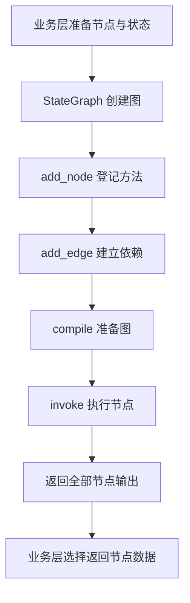

# AI 公共能力

本目录集中维护框架接入：LangGraph 编排执行，LangChain 创建模型与消息。流程业务位于 [workflow](../../workflow/README.md)，配置管理与调试台位于 modules。两个框架子目录共用本说明，不再分别维护 README。

| 目录 | 当前职责 |
|---|---|
| langgraph/engine.py | 注册节点、连接流程图、编译和执行 |
| langchain/model_client.py | 根据接入方式创建模型 |
| langchain/prompt_builder.py | 使用 ChatPromptTemplate 组装已准备好的消息 |

运行关系：workflow/runtime 准备节点 → LangGraph 引擎执行 → workflow/nodes 中的节点处理业务；模型节点、模型测试和调试台复用同一个 create_chat_model。

LangGraph 引擎直接接收现有 BaseNode、WorkflowState，不依赖运行模块的 Service、Repository、HTTP 或返回策略。模型创建仍直接使用 ModelConfig 实体，不增加重复配置对象。

## LangGraph

阅读入口：[langgraph/engine.py](langgraph/engine.py)。run_graph 接收已准备的节点对象、唯一开始节点ID、末端ID列表和独立 WorkflowState，返回按节点ID保存的 NodeOutput。

| 步骤 | 代码与含义 |
|---|---|
| 创建图 | StateGraph(WorkflowState)，声明图使用的状态结构 |
| register_nodes | add_node(node_id, node.run)，登记方法，此时不执行节点 |
| connect_edges | START 连接开始节点，各节点依赖通过 add_edge 连接，全部末端连接 END |
| execute_graph | compile 准备可执行图，invoke(initial_state) 才运行并等待完成 |



例如“开始 → 大模型 → 返回”会连接成“START → 开始 → 大模型 → 返回 → END”。列表形式 add_edge(source_ids, node_id) 等待全部直接上游，支持固定并行分支汇合；输入范围由运行模块提前准备，节点按ID读取，引擎不筛选数据。

业务返回节点与框架 END 含义不同：返回节点决定接口读取哪份数据，END 标记图路径结束。其他独立末端也参与本次同步执行，invoke 仍等待整次图完成；当前没有提前返回 HTTP、图缓存、循环或跨请求记忆。

WorkflowState 位于 workflow/data/execution，node_outputs、task_results 分别通过 Annotated 声明合并函数，LangGraph 使用它们合并状态增量。TYPE_CHECKING 中的 dataclass 元信息只帮助 IDE 类型检查，不成为运行状态字段。

run_task 用独立状态复用同一引擎。后续主图执行方法中调用它，采用框架支持的[节点内调用子图](https://docs.langchain.com/oss/python/langgraph/use-subgraphs#call-a-subgraph-inside-a-node)方式；调用方只提交 TaskResult，不把子图全部节点输出混入主图。当前完成内部隔离入口，动态分发和画布路由尚未接入，不自建调度器。

## LangChain

[model_client.py](langchain/model_client.py) 只创建模型，create_chat_model 根据接入方式选择 create_openai_model、create_anthropic_model、create_ollama_model、create_google_genai_model。直接接收完整 ModelConfig 实体，不拆开传连接参数，也不在本目录查询数据库或缓存。

配置由调用方通过 [模型缓存](../../modules/model_config/README.md#模型配置缓存) 准备，未命中的短会话在调用模型前关闭。Service 中最基本的调用是：

```python
model = create_chat_model(model_config)
answer = str(model.invoke(question).text)
```

invoke 由框架提供，text 读取回复正文。问题原样传入，不加跨请求历史。各集成沿用 SDK 的请求路径、鉴权、响应解析，以及输出长度、停止条件、超时和重试默认值；URL 原样传给 base_url，不补路径、删后缀或解析版本。

依赖为 langchain-core、langchain-openai、langchain-anthropic、langchain-ollama、langchain-google-genai。Ollama 配置 Key 时通过 client_kwargs 添加鉴权头，Google 使用 API Key 接入，API 版本沿用默认值；无需密钥的兼容服务使用 EMPTY 占位满足 SDK 构造要求。SecretStr 只隐藏打印值，不执行加密，业务日志不输出凭证。

### 消息与结构化结果

[prompt_builder.py](langchain/prompt_builder.py) 的 build_chat_prompt(context_text, system_prompt) 返回 ChatPromptValue。节点先选输入、转换文字并替换提示词命名变量，本文件再创建可选 SystemMessage 与固定用户模板“以下是本次流程传入的数据：”加 context；所选系统正文不二次解析，普通 JSON 花括号、换行和空白保留。未选提示词时只有用户消息。

模板使用 [ChatPromptTemplate](https://reference.langchain.com/python/langchain-core/prompts/chat/ChatPromptTemplate)，format_prompt 填充 context 后可直接交给 model.invoke。输入范围和变量语义由 workflow 负责，本文件不读取 WorkflowState。多份结果当前整理为一条用户消息，原始回复留在内部 LlmNodeOutput.message，默认业务输出为正文。

意图节点使用普通 invoke，再由 [PydanticOutputParser](https://reference.langchain.com/python/langchain-core/output_parsers/pydantic/PydanticOutputParser) 按 IntentAnalysisResult 解析任务列表；框架生成格式说明，不要求模型支持工具调用或原生 JSON Schema。任务类型和专用结果对象属于流程节点，不放到框架目录。

### 异常与维护

当前不封装各供应商错误分类，SDK 异常继续抛出，由公共异常处理返回 HTTP 500 与通用说明，服务端按请求ID查堆栈。不支持的接入方式返回现有 BusinessError；意图格式错误由专用节点转换为不含模型原文的业务错误，不自动重试。

MCP、Skills 和工具能力按实际需求再接入，本次不创建空目录。通用接入、消息模板和调用代码放这里，对应的配置管理留在 modules。
