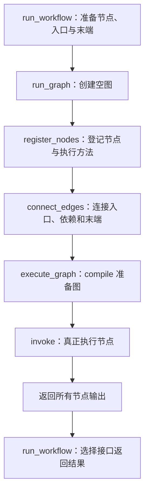

# LangGraph 图引擎

engine.py 集中使用 StateGraph、START、END、add_node、add_edge、compile、invoke。业务运行组织位于 [workflow_runtime](../../../modules/workflow_runtime/README.md)，节点实现位于 [workflow_nodes](../../../modules/workflow_nodes/README.md)。

## 执行入口

`run_graph(nodes, start_node_id, terminal_node_ids, initial_state)` 接收已准备好的节点对象、唯一入口ID、末端ID列表和本次状态。业务层运行前确认恰好有一个开始节点，入口使用 str，末端仍可有多个。节点对象已经带有 source_ids，不再重复转换节点配置。

执行过程：注册 node.run → 连接入口、节点依赖和末端 → compile → invoke。上游列表形式的 add_edge 等待全部指定上游，支持当前固定并行分支收敛。invoke 等待本次图运行完成，再返回按节点ID索引的所有输出。

engine.py 按步骤拆成普通函数，仍使用同一个图对象：

| 函数 | 职责 |
|---|---|
| run_graph | 总入口，创建空图并依次调用下面三个步骤 |
| register_nodes | 登记节点ID和 node.run 方法，此时不执行业务 |
| connect_edges | 连接 START、各节点的上游依赖、末端与 END |
| execute_graph | compile 准备可执行图，invoke 执行并返回所有节点输出 |

比如“开始 → 大模型 → 返回”，connect_edges 连接成“START → 开始 → 大模型 → 返回 → END”；独立结束的其他支路也连接到 END。遇到多个上游的收敛节点，则使用列表连线等待全部上游。构建阶段只登记执行关系，业务方法在 invoke 时由 LangGraph 调度。

引擎只使用 workflow_nodes/base 中的节点与状态契约，不读取数据库、不创建业务节点、不选择模型，也不决定哪些结果作为 HTTP 响应。workflow_runtime/executor.py 确认唯一返回节点且它没有下游，再从引擎的全部输出中只取该节点的数据。业务返回节点只是普通节点，框架 END 是终点标记；invoke 仍等待所有分支完成。

每次运行创建独立图和状态；当前没有图缓存、条件分支、循环、后台任务或跨请求记忆。节点日志由 BaseNode 记录，流程日志由运行 Service 记录，框架异常继续向上交给现有公共处理。
