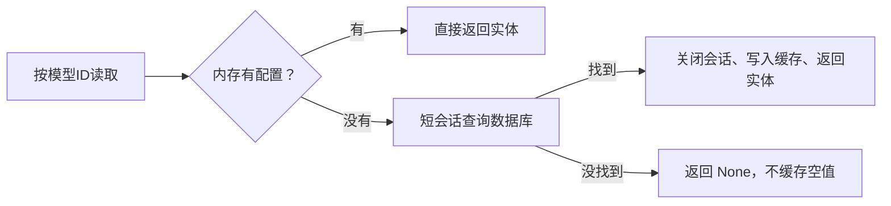

# 模型配置管理（个人极简版）

本包按个人使用维护：接口接收 JSON 字典，直接创建或修改 ModelConfig 数据库实体，不再维护 schemas.py、入参/出参 DTO、字段枚举、必填、长度、URL 格式或 ID/页码范围校验。不自动去空格、转换 URL 或把空字符串改成 null。

## 文件职责

| 文件 | 职责 |
|---|---|
| router.py | 接收 JSON，注入 Service，包装统一 Result |
| service.py | 直接使用实体完成增删改查和模型测试，写操作通过 @transactional 控制事务 |
| cache.py | 内部模型调用的统一配置读取入口，内存命中直接返回，未命中用短会话查库 |
| repository.py | SQLAlchemy 查询、保存和删除 |
| entity.py | 表结构、has_api_key 计算值、统一排除 Key 的 to_dict |

get_by_id 使用 Session.get 按主键查询，返回 ModelConfig 实体或 None。部分 PyCharm 版本会将结果误判为模型类，因此在返回处用 typing.cast 明确类型；它不转换对象、不校验字段，也不改变查询行为。

## 模型配置缓存

cache.py 的 get_model_config(model_id) 供流程节点创建、模型测试和调试台共用。Map 的 key 是模型配置ID，value 是完整 ModelConfig 实体；未命中时新建短会话，以 include_api_key=True 查询，退出事务并关闭会话后才缓存实体。不缓存 Session，也不缓存 None，配置不存在时由调用方沿用现有业务错误。



缓存仅供内部只读使用，普通配置列表和详情仍查询数据库且不读取 Key。线程锁保护未命中加载与缓存失效，避免同时加载同一配置或把已失效旧值重新填回；不记录实体、地址或 Key，只在 DEBUG 日志记录模型ID和命中情况。

新增、修改、删除的事务提交成功后调用 invalidate_model_config(model_id)，下次使用重新查库；提交失败不清除缓存。缓存是每个进程一份的字典，重启后清空；直接在数据库中改配置不会主动刷新，多进程之间也不自动同步。

公共 Base 只提供 id；模型配置不维护 created_at、updated_at。旧表执行 sql/remove_model_config_time_columns.sql 删除这两列；初始化脚本已经是去掉时间字段的最终结构，前端也不再展示更新时间。

## 接口

| 方法 | 路径 | 用途 |
|---|---|---|
| POST | /api/model-configs | JSON 直接 ModelConfig(**request_data)，成功 201 |
| GET | /api/model-configs?page=1&page_size=20 | 按ID倒序分页，不增加每页数量上限 |
| GET | /api/model-configs/{id} | 返回实体字段 |
| PUT | /api/model-configs/{id} | 提交什么字段就更新什么字段；未提交的保持原值 |
| DELETE | /api/model-configs/{id} | 删除记录，成功返回 data=null |
| POST | /api/model-configs/{id}/test | 使用保存的实体进行一次真实模型调用，无请求体 |

请求示例：

```json
{
  "model_name": "本地模型",
  "model_code": "你的模型标识",
  "model_provider": "ollama",
  "model_base_url": "http://127.0.0.1:11434",
  "model_api_key": null
}
```

保存时不判断字段内容是否有效，调用时再由对应 SDK 或模型服务处理。未定义字段不能成为数据库列：新增时由 SQLAlchemy 构造规则处理，修改时非映射属性不会持久化。模型表已有的非空、类型和长度约束仍生效，模型表结构保持一致。JSON 对象和 URL 整数参数的基本解析仍由 FastAPI 负责，格式错误仍可能返回 422。

## Key 与返回

列表、详情 SELECT 不取出 model_api_key，只计算 has_api_key；模型测试和问答通过 include_api_key=True 读取完整实体。has_api_key 是 SQL 查询表达式，不是新增表字段。

新增、修改返回的实体也可能含 Key，所以所有配置响应统一调用 to_dict，只读取实体映射字段并排除 model_api_key，不再转换成另一套响应模型。Has Key 状态和 id、名称、模型标识、地址等字段直接来自实体。

接口更新时 Key 不传保留，传 null 就保存 NULL，传空字符串就原样保存空字符串。前端编辑仍提供留空保留、输入替换、勾选清除的快捷操作。Key 当前明文保存，不在响应或日志中返回。

## 写操作事务

create、update、delete 是外层业务入口，调用各自的 create_in_transaction、update_in_transaction、delete_in_transaction。事务内方法使用公共 `@transactional`，与 Repository 复用当前请求的 db_session；返回外层方法时事务已经提交，外层再清除缓存。这样无需引入事务回调，提交失败也不会提前清除缓存。业务方法内日志表示执行动作，装饰器在提交成功后记录事务日志。

列表、详情不加装饰器；模型测试通过缓存入口按需查询，不开启请求会话的事务。当前不支持已开启事务或装饰器之间的嵌套调用。

## 模型测试

Service 通过 get_model_config 取得完整实体，缓存未命中时查询会话会先提交并关闭，再通过 [ai/langchain/model_client.py](../../infrastructure/ai/langchain/model_client.py) 中的 create_chat_model(model_config) 创建模型，直接调用 model.invoke("Reply with OK only.")。会话使用 expire_on_commit=False，已加载字段仍可读取，不需要拆成多个参数或一直占用数据库连接。

成功返回 data={"elapsed_ms":123}，不保存测试历史，不返回模型原始回复。SDK 调用失败沿用公共异常处理，返回 HTTP 500 和“服务器内部错误”，暂不区分各家的模型错误；测试为真实请求，可能产生费用。

修改行为时同步维护本文件；默认不重新添加字段校验、DTO 或额外转换，确有需求时再讨论。
