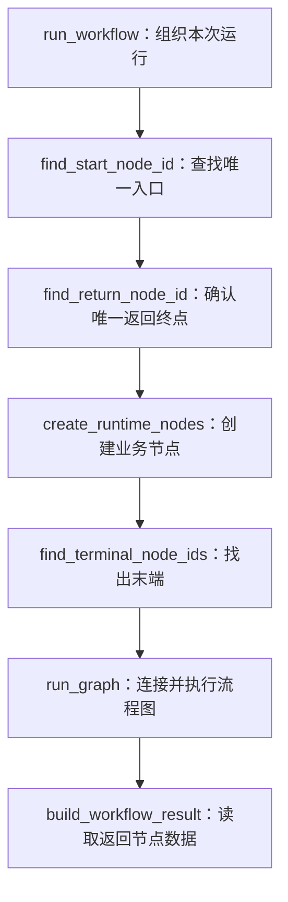

# 流程运行（极简版）

本包负责统一加载配置、准备节点和选择返回数据，配置增删改查由 [workflow_config](../workflow_config/README.md) 维护，具体节点由同级 [workflow_nodes](../workflow_nodes/README.md) 提供，框架构建和执行集中在 [ai/langgraph](../../infrastructure/ai/langgraph/README.md)。当前提供开始、大模型、收敛、返回节点，前端只展示返回节点的数据，排查使用后端日志。

## 文件职责

| 文件 | 职责 |
|---|---|
| router.py | 运行接口、请求依赖与公共 Result 返回 |
| service.py | 加载配置、执行流程、记录开始/完成/失败日志 |
| config_loader.py | JSON 读取为对象，查询配置和模型后结束事务 |
| data/ | 流程连线、流程定义、运行配置和最终结果，每个对象一个文件 |
| executor.py | 准备节点和入口末端、调用图引擎、选择返回数据 |

调用顺序：router → service → config_loader → Repository。配置就绪后，executor 用 workflow_nodes.factory 创建节点、准备各节点上游和入口末端，再调用 ai/langgraph/engine.py 的 run_graph。引擎注册 node.run、连接图并执行，返回所有节点输出；executor 选择接口返回的数据。节点不查询数据库、不调用后续节点。等待模型时不占用查询事务，后续缓存从加载入口接入。

parse_workflow_definition 读取 JSON 后，使用普通 for 循环分别调用 WorkflowNode.from_dict(node_data)、WorkflowEdge.from_dict(edge_data)，再 append 到对应列表。字段读取和对象创建封装在各自类中，节点的 WorkflowNodeConfig 也在 WorkflowNode 内创建；解析入口只组织读取，实际执行对象仍由 workflow_nodes.factory 创建，不增加额外转换层。

executor 在创建节点前确认恰好有一个开始节点和一个返回节点；返回节点必须接收一个上游且没有下游，不符合时抛出公共 BusinessError（400）。入口以 start_node_id 单个字符串传给引擎，全部业务末端仍用列表。开始节点可以连接多条支路，其他分支可以独立结束；保存配置时仍按原文保存，结构检查只在运行时进行。

executor.py 中的 run_workflow 只保留步骤顺序，辅助函数继续放在同一个文件，使用现有类型：

| 步骤 | 职责 |
|---|---|
| find_start_node_id | 查找唯一开始节点，缺少或重复时抛出业务异常 |
| find_return_node_id | 查找唯一返回节点，确认一个上游、没有下游 |
| create_runtime_nodes | 整理上游关系，通过 factory 创建节点对象，此时不执行业务 |
| find_terminal_node_ids | 根据连线找出没有下游的节点，保留定义中的节点顺序 |
| run_graph | 调用 AI 层图引擎，完成登记、连线和执行 |
| build_workflow_result | 只取返回节点的输出并包装为 WorkflowResult，未执行到返回节点时抛出业务异常 |



这些函数只处理已经加载到内存的对象，不增加配置缓存、额外数据对象或数据库查询。修改返回规则看 build_workflow_result，修改节点创建看 create_runtime_nodes。

节点逻辑从 [workflow_nodes/base/base_node.py](../workflow_nodes/base/base_node.py) 开始阅读，再看 node 下的具体节点与外层 factory.py；公共 run 统一读取输入、调用具体业务、记录日志并提交输出。节点包只依赖自己的数据对象和所需公共能力，不反向导入运行包。

再读 executor.py，了解如何识别入口、末端和选择最终返回。框架代码在 ai/langgraph/engine.py：run_graph 依次调用 register_nodes 登记执行方法、connect_edges 建立依赖、execute_graph 编译并执行；步骤图见 [图引擎说明](../../infrastructure/ai/langgraph/README.md)。connect_edges 将上游ID列表交给 graph.add_edge(source_ids, node_id)，由 LangGraph 等待全部上游后再运行当前节点。比如“开始 → 大模型A、大模型B → 收敛 → 大模型C → 返回”，收敛输出形如 {"llm_a":"回答A","llm_b":"回答B"}。分支长度不同时也等待所有指定上游；当前不处理条件分支中未执行的路径，也未实现循环。

节点对象只保存配置；本次输入输出始终放在独立 WorkflowState 中。节点ID沿用画布保存的值，加载或运行时不重新生成，避免破坏连线引用。

## 对象与接口

固定结构使用标准库 dataclass，通过属性访问，例如 runtime_config.workflow.nodes、node.config.model_config_id、result.payload。[workflow_nodes/base/data/](../workflow_nodes/base/data/README.md) 按对象保存节点定义、节点配置、WorkflowInput、WorkflowState；本包 [data/](data/README.md) 按对象拆分 WorkflowEdge、WorkflowDefinition、WorkflowRuntimeConfig、WorkflowResult。每个类型只定义一次，各处直接导入所属文件，不维护旧路径转发。

字段说明使用中文 Attributes，支持 PyCharm 补全和快速文档。实际业务内容可以是文字、对象或列表，因此只有动态内容及 HTTP/JSON 边界保留 Any；按ID索引的字典继续保留。

WorkflowState 在 TYPE_CHECKING 块中声明 dataclass 自动生成的元信息，兼容 PyCharm 对 LangGraph 状态类型约束的识别。该声明不参与运行，图状态仍只有 inputs、node_outputs；不使用忽略检查或 Any 强制转换。

`POST /api/workflow-configs/{id}/run`，请求体 `{"payload":"你好"}`。成功 data 为 `{"payload":"模型回答"}`，失败交给公共异常处理，不返回中间步骤、额外调试结构或运行历史。接口路径、数据库表及流程文本字段保持现状。

节点只提交自己的输出，WorkflowState 保存本次 inputs、node_outputs，merge_node_outputs 合并存储增量；它不是收敛节点，也不负责等待。executor 识别全部无下游的末端，引擎将其连接 END；其中只有 return_node_id 对应的输出进入响应。比如一条支路“大模型B → 返回”，另一条支路“大模型C”独立结束，C 仍执行，但结果不混入响应。

返回节点不是框架 END，也不触发提前返回 HTTP。当前同步等待整次图运行完成，其他分支未处理的异常也会影响本次请求；后台任务和队列后续再做。大模型和返回节点都接收一个上游，多路结果先接收敛节点；判断、循环和工具能力后续再做。

## 后端日志

复用现有 uvicorn.error 日志对象，在 PyCharm 或启动控制台查看：

- INFO：请求ID、流程ID、节点ID和名称，以及开始、完成、失败信息；失败记录堆栈。
- DEBUG：额外记录每个节点的输入、输出正文，不记录模型配置或 Key。

默认按普通启动命令运行即可，排查时临时使用：

```powershell
uv run python -m uvicorn main:app --reload --log-level debug
```

节点格式见 [最小流程定义](../../../../docs/workflow-definition.md)。
