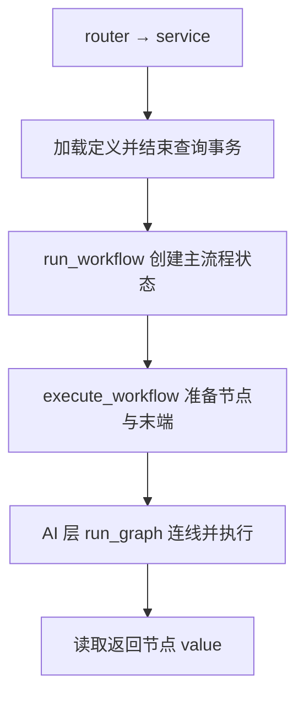

# 流程运行与节点

一条保存的流程就是一个 Agent。本包集中维护流程共用对象、运行组织和节点业务；配置增删改查仍在 [modules/workflow_config](../modules/workflow_config/README.md)，框架调用集中在 [infrastructure/ai](../infrastructure/ai/README.md)。当前画布支持固定串行和并行分支，任务隔离运行已有内部入口，尚未接入自动分发。

## 目录与阅读顺序

```text
workflow/
├─ data/
│  ├─ definition/        保存的流程、节点、连线与配置
│  ├─ execution/         图状态、节点输入与节点输出
│  ├─ task/              运行任务与任务结果
│  └─ io/                整个流程的输入与最终返回
├─ runtime/
│  ├─ router.py          HTTP 接口与服务注入
│  ├─ service.py         加载定义、运行流程、记录流程日志
│  ├─ config_loader.py   查询流程文本，结束事务后解析为对象
│  ├─ executor.py        准备节点和入口末端，执行并选择返回结果
│  └─ task_executor.py   分配任务ID，以独立状态复用节点组
└─ nodes/
   ├─ base/              节点基类、文字转换和提示词变量处理
   ├─ node/
   │  ├─ basic/          开始、返回、收敛节点
   │  └─ llm/            普通大模型、意图分析及专用 data 对象
   └─ factory.py         选择节点类型，准备模型与可选提示词资源
```

建议先读 [nodes/base/base_node.py](nodes/base/base_node.py)，再读具体节点、[runtime/executor.py](runtime/executor.py)，最后对照 [AI 框架说明](../infrastructure/ai/README.md) 阅读 LangGraph 引擎。字段含义和方法参数写在代码的中文文档字符串中，子目录不再单独维护 README。

依赖方向：runtime 使用 data、nodes 和 AI 引擎；nodes/base 使用共用 data，具体节点使用 base 及必要的模型能力。data 不引用运行服务、节点实现或引擎，节点不反向导入 runtime。引擎复用 BaseNode、WorkflowState 契约，不增加重复的框架 DTO。

## 数据对象

共用对象按职责放入 data/ 的四个子包，保持一类一文件，各处直接导入对应文件，不通过 __init__.py 转发。definition 描述保存的结构，execution 承载本次执行数据，task 描述拆出的工作，io 是调用方的输入与返回。

| 子包 | 对象 | 用途 |
|---|---|---|
| definition | WorkflowDefinition、WorkflowEdge | 开始与返回ID、节点列表和连线 |
| definition | WorkflowNode、WorkflowNodeConfig、PromptVariable | 保存的节点定义、所选资源、输入范围及变量来源 |
| execution | WorkflowState | 当前图的 inputs、node_outputs、task、task_results |
| execution | NodeContext、NodeOutput | 当前节点选中的输入与独立产生的业务输出 |
| task | WorkflowTask、TaskResult | 运行时任务与按任务ID关联的最终结果 |
| io | WorkflowInput | 原始用户文字 text 与可选 user_id |
| io | WorkflowResult | HTTP 返回的数据，payload 允许文字、对象或列表 |

模型节点的专用对象放在 nodes/node/llm/data/：LlmNodeResources 保存模型与可选提示词实体，LlmNodeOutput 继承 NodeOutput 并保留完整模型消息；IntentTask、IntentAnalysisResult 使用 Pydantic BaseModel，供 LangChain 解析器直接解析，其余固定运行结构使用 dataclass。普通 LLM 与意图分析同属模型调用能力，使用独立节点类并共用这些对象。

JSON 只在加载和响应边界解析、序列化。parse_workflow_definition 使用普通 for 循环调用 WorkflowNode.from_dict、WorkflowEdge.from_dict；字段读取和嵌套配置创建放在对应对象中。数据库仍原样保存定义文本，画布坐标等扩展信息不因运行对象未读取而丢失。

## 流程运行

`POST /api/workflow-configs/{id}/run` 接收 `{"text":"你好","user_id":"user_001"}`，user_id 可省略或为 null。FastAPI 直接解析为 WorkflowInput，成功 data 为 `{"payload":"最终结果"}`，payload 也可以是对象或列表；异常沿用公共处理。接口不返回内部模型消息或全部节点记录。

运行步骤：



executor.py 按小函数组织：

| 函数 | 职责 |
|---|---|
| run_workflow | 为普通请求创建状态，再调用 execute_workflow |
| execute_workflow | 主流程与任务共用的执行步骤，最后选择返回结果 |
| create_runtime_nodes | 整理直接上游、确认入口返回结构、创建业务节点 |
| find_upstream_node_ids | 找出当前节点的全部上游，去重并排除无关分支 |
| find_terminal_node_ids | 根据连线识别没有下游的末端 |
| build_workflow_result | 只取指定返回节点的 value，未执行到时抛出业务异常 |

每个可运行的节点组恰好一个开始和一个返回节点，定义顶层明确保存 start_node_id、return_node_id。准备上游关系时确认ID与唯一对应类型一致，返回节点接收一个上游且没有下游；草稿可保存 null，运行时必须指定。保存接口不解析或改写定义，完整格式与示例见 [流程协议](../../../docs/workflow-definition.md)。

factory 在节点创建阶段按需调用 get_model_config、get_prompt_config，命中直接使用实体，未命中用短会话查询。调用模型前会话已关闭，缓存实体仅内部只读，节点运行时不查库。流程定义本身尚未缓存。

## 节点

BaseNode.run 统一完成 `read_input → execute → 记录日志 → 提交本节点输出`。节点对象只保存配置，运行数据保存在 WorkflowState，节点ID沿用画布定义。基础数据流节点放 nodes/node/basic/，模型调用节点放 nodes/node/llm/；新增节点按实际职责归组，并维护 factory.py，节点业务方法不自行调用下游。后续接入工具、控制等能力时再增加对应分组。

| 节点 | 行为 |
|---|---|
| StartNode | 主流程输出 inputs.text，任务中输出 task.question；原始输入保留 |
| LlmNode | 组装所选输入和提示词，调用模型，业务结果默认是正文 |
| IntentAnalysisNode | 内置意图说明，普通调用后由 PydanticOutputParser 解析 tasks |
| MergeNode | 将当前输入范围的结果按上游ID打包成对象 |
| ReturnNode | 原样输出一个直接上游的 value，作为最终返回数据 |

意图任务类型为 database、knowledge、chat、unsupported；可选提示词仅补充业务要求。格式解析失败返回不含模型原文的 BusinessError，不自动重试，也不伪装成空任务。实际分类质量需要使用所选模型确认。示例见 [意图分析](../../../docs/examples/intent-analysis.json)，模型ID按实际配置替换。

## 输入范围与提示词

节点使用“统一保存、按需读取”：node_outputs 按节点ID保存 NodeOutput，value 为当前业务结果，不维护向下游传递的上下文副本。LLM、意图分析、收敛独立选择 input_scope：all_upstream 默认读取整条上游依赖链，direct_upstream 仅读取直接上游，可以有多个；运行模块提前准备 input_ids，执行时按ID读取，无关分支不会混入。

例如 a、c → b（总结）→ d，b 选择直接上游就读取 a、c；d 也选择直接上游就只读取 b。原始结果仍保留，其他节点可独立选择。LangGraph 使用列表连线等待全部直接上游；LLM 无需先经过收敛节点。当前只适用于固定分支，动态路径的等待与读取后续再接入。

nodes/base/text.py 使用现有 Pydantic 序列化能力把对象、列表转换为保留中文的 JSON，文字原样返回。提示词变量由 nodes/base/prompt_variables.py 统一处理：`{question}` 始终取原始问题，`{upstream}` 取当前输入范围，其他命名变量按 prompt_variables 读取指定上游。普通 JSON 和双花括号保留，不递归替换，缺少来源明确报错；不改写或缓存渲染结果。

LangChain 消息模板接收准备好的文字。普通 LLM 渲染所选提示词，意图节点只渲染补充正文；内置分类和框架结构说明保持原文。多份结果当前进入一条用户上下文消息，LlmNodeOutput.message 仅内部保留，不自动传递完整角色消息列表。

## 任务运行基础

runtime/task_executor.py 提供内部能力，尚未接入画布、HTTP 或自动任务分发：

1. create_workflow_tasks(intent_result) 保留 type、question，为每项任务生成服务端 UUID。重复类型、问题也保留，空列表仍返回空列表。
2. run_task(task_definition, original_input, task) 复制原始输入，创建独立 WorkflowState，复用 execute_workflow 和现有节点组；每组仍需一个开始和一个返回节点。
3. 开始节点输出 task.question；inputs.text、inputs.user_id 和提示词 `{question}` 保留原始请求含义。
4. 返回 TaskResult(task_id, value)，失败原样抛出，不返回伪成功结果。

后续主图的任务执行方法选定节点组后，调用并提交结果增量：

```python
result = run_task(task_definition, state.inputs, task)
return {"task_results": {result.task_id: result}}
```

每项任务有独立 node_outputs，相同节点ID不会覆盖；主图的 merge_task_results 只按任务ID合并最终结果，不接收任务内部节点记录。merge_node_outputs、merge_task_results 只合并状态增量，不负责调度或等待。两者通过 Annotated 交给 LangGraph 使用，图内执行仍由框架负责。

当前每项任务单独准备节点、构建图，未增加图缓存、任务表、依赖规划或自建线程池。按类型选路、动态分发、画布配置和汇总是下一步能力，当前意图节点仍只输出任务列表。

## 日志与边界

Service 记录流程开始、成功、失败及耗时；任务入口记录任务ID、类型和执行状态；BaseNode 记录请求ID、任务ID、节点ID与名称。主流程任务ID为 None。INFO 不记录模型配置、Key 或提示词正文，DEBUG 才记录节点输入输出。

排查时使用 `uv run python -m uvicorn main:app --reload --log-level debug`，异常堆栈由流程服务与公共异常处理记录。

接口当前同步等待整次图完成，其他独立末端仍参与执行，其异常会影响请求；返回节点不表示后台执行。运行数据只保留在本次内存，不写回配置。跨请求记忆、后台队列、循环、工具和查询能力按后续需求增加。
